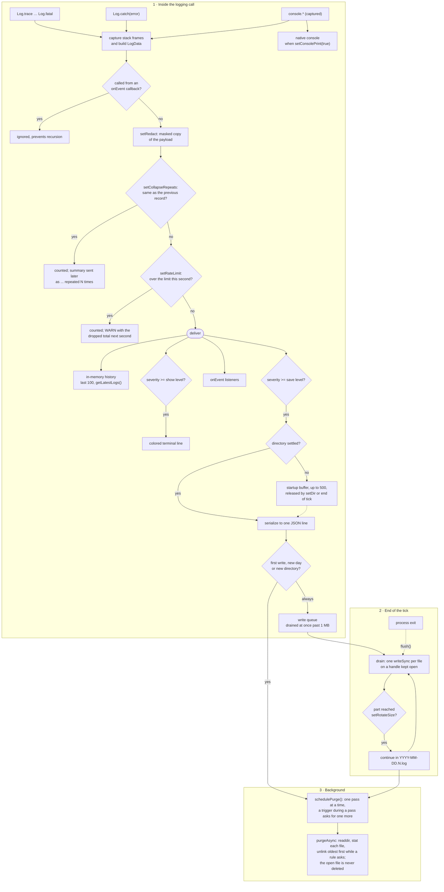

# wa-log

A logging library for Node.js and TypeScript with colored terminal output, daily
JSON Lines persistence, in-memory history, `console.*` capture, event listeners,
and safeguards for long-running applications.

Key features:

- seven severity levels, from `TRACE` to `FATAL`;
- independent console and file thresholds;
- daily files with optional size-based rotation;
- retention by age, total directory size, and file count, applied in the background;
- automatic capture of `console.trace`, `debug`, `log`, `info`, `warn`, and `error`;
- persisted log querying and filtering;
- sensitive-data redaction;
- duplicate collapsing and per-second rate limiting;
- optional process crash capture;
- typed API compatible with Node.js 18 and newer.

## Installation

```bash
npm install wa-log
```

With TypeScript or `import` syntax:

```ts
import { Log, LogData, LogLevel } from "wa-log";
```

With CommonJS:

```js
const { Log, LogLevel } = require("wa-log");
```

## Quick start

```ts
import { Log, LogLevel } from "wa-log";

Log.setDir("./logs");
Log.setLevel(LogLevel.INFO, LogLevel.DEBUG);
Log.setObjectPrint(true);

Log.info("API", "Server started", { port: 3000 });
Log.warn("AUTH", "Access attempt rejected", { userId: 42 });
```

The first level passed to `setLevel` controls console output; the second controls
file storage. In this example, `INFO` and above appear in the terminal, while
`DEBUG` and above are saved.

Output follows this format:

```text
2026-08-18 22:32:20.141 INFO  [API] src/server.ts:18:5 Server started
    └─ { port: 3000 }
```

The name, full-path, and filename columns start compact and grow with the content
observed by the process. Their limits are 20 characters for the name, 80 for the
full path, and 30 for the filename. Content beyond a limit is shortened with `…`
while preserving the most useful part.

## Severity levels

Levels are numeric and ordered. A threshold includes the selected level and every
more severe level.

| Level | Value | Recommended use |
| --- | ---: | --- |
| `TRACE` | 0 | Detailed internal state and execution flow |
| `DEBUG` | 1 | Development diagnostics and investigation |
| `LOG` | 2 | Generic output, including `console.log` |
| `INFO` | 3 | Normal operational events |
| `WARN` | 4 | Unexpected situations the application recovered from |
| `ERROR` | 5 | Failed operations or requests |
| `FATAL` | 6 | Failures that compromise or terminate the process |

Default configuration:

```ts
// Console: INFO, WARN, ERROR, and FATAL
// File: every level, starting at TRACE
Log.setLevel(LogLevel.INFO, LogLevel.TRACE);
```

Even when a record is below both console and file thresholds, it still enters the
in-memory history and is delivered to event listeners.

## How a record flows

Every record goes through the same path, whichever API created it. Only the first
stage runs inside the logging call; disk writes wait for the end of the tick, and
retention runs in the background afterward.



- Records below both thresholds still reach the history and the listeners.
- The repeat and rate-limit summaries go through `deliver` like any other record.
- Retention is only scheduled when at least one `setPurge*` rule is set.

## Use cases

### Production API or service

Configure the destination and safeguards early in the application bootstrap:

```ts
import { Log, LogLevel } from "wa-log";

Log.setDir("./var/log");
Log.setLevel(LogLevel.INFO, LogLevel.DEBUG);
Log.setObjectPrint(true);
Log.setRedact(["password", "token", "authorization", "cookie"]);
Log.setRotateSize(50 * 1024 * 1024);   // 50 MB per part
Log.setPurgeDays(30);                  // keep 30 days
Log.setPurgeSize(500 * 1024 * 1024);   // cap the directory at 500 MB
Log.setPurgeFiles(100);                // and at 100 files
Log.setCatchCrashes(true);

Log.info("BOOT", "Application ready", { environment: process.env.NODE_ENV });
```

To select the directory before application imports execute, prefer `WA_LOG_DIR`.
Environment variables are read as soon as `wa-log` is imported.

### Request-scoped context

Use `name` as a short category and keep variable data in the payload:

```ts
Log.info("HTTP", "Request completed", {
    requestId: "req-8f41",
    method: "GET",
    path: "/customers/42",
    statusCode: 200,
    durationMs: 18
});
```

The brackets make the name a clear visual tag: `[HTTP]`, `[DB]`, `[AUTH]`, or
`[WORKER]`.

### Exception handling

`Log.catch` accepts `unknown`, so a modern TypeScript `catch` binding can be passed
directly. It also handles strings and plain objects thrown instead of `Error`
instances.

```ts
try {
    await processPayment();
} catch (error: unknown) {
    Log.catch(error, LogLevel.ERROR, {
        orderId: "order-125",
        operation: "payment"
    });
}
```

For an `Error`, the original name, message, and stack are preserved. Other thrown
values use `NonError` as their log name.

### Burst-prone worker

```ts
Log.setCollapseRepeats(true);
Log.setRateLimit(200);

for (const job of jobs) {
    try {
        await run(job);
    } catch (error) {
        Log.catch(error, LogLevel.ERROR, { jobId: job.id });
    }
}
```

Consecutive records with the same level, name, and message are collapsed. The
per-second limit rejects excess records and later emits a `WARN` stating how many
were dropped. Both safeguards are disabled by default.

### Metrics or observability integration

```ts
const countErrors = (entry: LogData) => {
    metrics.increment("application_errors", {
        source: entry.name
    });
};

Log.onEvent(LogLevel.ERROR, countErrors);

// When the listener is no longer needed:
Log.offEvent(LogLevel.ERROR, countErrors);
```

Use `"ANY"` to receive every level. Logs created through `Log` inside a listener
are ignored by the `wa-log` pipeline to prevent recursion; `console.*` calls inside
the listener go directly to the native console.

### Querying persisted history

```ts
const start = new Date("2026-08-18T00:00:00-03:00");
const end = new Date("2026-08-18T23:59:59.999-03:00");

const failures = Log.getLogs(start, end, LogLevel.ERROR);
const authWarnings = Log.getLogs(start, end, LogLevel.WARN, "AUTH");
```

The severity filter is a threshold: `ERROR` also returns `FATAL`. The name filter
is exact and case-sensitive.

## `console.*` capture

Importing the library automatically wraps the native methods:

| Call | Recorded level | Name |
| --- | --- | --- |
| `console.trace(...)` | `TRACE` | `CONSOLE` |
| `console.debug(...)` | `DEBUG` | `CONSOLE` |
| `console.log(...)` | `LOG` | `CONSOLE` |
| `console.info(...)` | `INFO` | `CONSOLE` |
| `console.warn(...)` | `WARN` | `CONSOLE` |
| `console.error(...)` | `ERROR` | `CONSOLE` |

The first argument becomes the message, and all remaining arguments are stored in
the `object` field. By default, the original call also passes through to the native
console.

```ts
Log.setConsolePrint(false);
```

`setConsolePrint(false)` disables only that direct native output. The structured
record continues through the threshold configured with `setLevel`. With native
pass-through enabled, `console.info`, `warn`, and `error` may therefore produce both
their original output and a formatted record when they meet the display threshold.

## Terminal formatting

```ts
Log.setPathPrint(true);    // full path + line:column

Log.setPathPrint(false);
Log.setFilePrint(true);    // filename + line:column only

Log.setFilePrint(false);   // omit the source location
Log.setObjectPrint(true);  // payload on a separate indented line
```

`setPathPrint(true)` takes precedence over `setFilePrint(true)`. To display only the
filename, disable the full path first.

Control characters and ANSI escape sequences received in names and messages are
removed by default so untrusted content cannot alter the terminal. To allow raw
content:

```ts
Log.setSanitizePrint(false);
```

## Log files

### Directory and format

The default directory is `./logs`, resolved from the current working directory.
Each file line is one complete JSON object in JSON Lines format:

```text
logs/
└── 2026-08-18.log
```

```json
{"date":"2026-08-19T01:32:20.141Z","localDate":"2026-08-18T22:32:20.141Z","severity":3,"name":"API","message":"Server started","object":{"port":3000},"local":"src/server.ts","cursor":"18:5","stack":["at src/server.ts:18:5"]}
```

Select another destination with:

```ts
const changed = Log.setDir("/var/log/my-app");
```

`setDir` creates intermediate directories and returns `true` when the requested
destination is selected. On failure, it returns `false` and falls back to `./logs`.

Records created before `setDir` are held briefly in memory so application imports do
not write to the wrong location. The wait ends when `setDir` is called or at the end
of the current tick, whichever happens first.

### Writes and flushes

Lines are queued and written as a batch once per tick, preserving order while keeping
a single file descriptor open. The queue is also drained during normal process exit.

```ts
Log.flush();
```

Call `flush` before handing the file to another process, taking a backup, or
performing an external read that must immediately see the latest records. When
`flush` returns, the pending queue has been written.

### Size-based rotation

```ts
Log.setRotateSize(50 * 1024 * 1024);
```

Without a limit, there is one file per day. With rotation enabled, subsequent parts
are named `2026-08-18.1.log`, `2026-08-18.2.log`, and so on. A record is never split
between files, and a restarted process continues after the highest existing part.

The limit is measured in bytes as written to disk (UTF-8), so accented or wide
characters count for what they actually take. A part is closed as soon as the next
record would not fit; only a single record larger than the whole limit goes out
alone, in a part of its own, exceeding it.

Opening a new part also triggers the retention rules, so `setPurgeSize` and
`setPurgeFiles` hold during the day instead of only after midnight.

Pass `0` to disable rotation.

### Retention

```ts
Log.setPurgeDays(30);
Log.setPurgeSize(500 * 1024 * 1024);
Log.setPurgeFiles(100);
const removed = Log.purge();
const removedLater = await Log.purgeAsync();
```

The rules can be combined; the oldest files go first, and a file is deleted when any
rule asks for it. `setPurgeFiles` counts the file being written, so `setPurgeFiles(10)`
keeps at most 10 files in the directory. Only files matching `YYYY-MM-DD.log` or
`YYYY-MM-DD.N.log` are considered. The currently open file is never deleted.

The automatic passes run when the directory changes, when the day changes, and when
rotation opens a new part. They never block a log call: the work is scheduled for
the end of the tick and walks the directory with asynchronous filesystem calls, one
at a time, so a pass never holds more than one thread of the libuv pool shared with
the application. Only one pass runs at a time; a trigger during a pass schedules one
more pass after it, as shown in [How a record flows](#how-a-record-flows). A pass in progress finishes before the process exits on its own;
`process.exit()` cuts it short, and the next start picks up the remaining work.

`purgeAsync` runs a pass the same way and returns a `Promise` with the number of
files removed. It never rejects. A call made while a pass is running joins it.

`setPurgeDays`, `setPurgeSize`, `setPurgeFiles`, and `purge` run synchronously and
return the number of files removed by their immediate pass. They are meant for
startup or maintenance code; use `purgeAsync` anywhere latency matters.

Pass `0` to disable any rule.

## API reference

### Creating records

Every method below accepts a name, a message, and an optional payload. They return
`void`.

```ts
Log.trace(name, message, object?);
Log.debug(name, message, object?);
Log.log(name, message, object?);
Log.info(name, message, object?);
Log.warn(name, message, object?);
Log.error(name, message, object?);
Log.fatal(name, message, object?);
```

| Parameter | Description |
| --- | --- |
| `name` | Short record category, displayed between brackets |
| `message` | Human-readable event description |
| `object` | Optional structured context stored with the record |

#### `Log.catch(error, severity?, object?)`

Records an exception or any other thrown value. The default level is `INFO`. The
source location comes from the error stack or, when no stack exists, from the point
where `catch` was called.

### Configuration

| Function | Description | Default | Returns |
| --- | --- | --- | --- |
| `setLevel(show, save)` | Sets the minimum console and file levels | `INFO`, `TRACE` | `void` |
| `setDir(dir)` | Creates and selects the log directory | `./logs` | `boolean` |
| `setPathPrint(print)` | Shows or hides the full source path in the terminal | `true` | `void` |
| `setFilePrint(print)` | Shows or hides the filename when full-path output is disabled | `true` | `void` |
| `setObjectPrint(print)` | Shows or hides the payload in the terminal; files, history, and events are unchanged | `false` | `void` |
| `setConsolePrint(print)` | Controls native pass-through for captured `console.*` calls | `true` | `void` |
| `setStackDepth(frames)` | Keeps the call site plus this many frames; a value below 1 restores the runtime default | runtime (7 frames) | `void` |
| `setSanitizePrint(sanitize)` | Removes or permits control characters received in content | `true` | `void` |
| `setRedact(keys)` | Recursively masks the specified payload keys; an empty list disables redaction | off | `void` |
| `setCollapseRepeats(collapse)` | Collapses equivalent consecutive records | `false` | `void` |
| `setRateLimit(perSecond)` | Sets the maximum accepted records per second; `0` disables it | `0` (off) | `void` |
| `setRotateSize(bytes)` | Sets the maximum size of a daily part; `0` disables rotation | `0` (off) | `void` |
| `setPurgeDays(days)` | Sets age-based retention; `0` disables the rule and runs a purge pass | `0` (off) | `number` |
| `setPurgeSize(bytes)` | Sets the directory size budget; `0` disables the rule and runs a purge pass | `0` (off) | `number` |
| `setPurgeFiles(count)` | Sets the maximum number of log files, the current one included; `0` disables the rule and runs a purge pass | `0` (off) | `number` |
| `setCatchCrashes(enabled)` | Installs or removes fatal process error handlers | `false` | `boolean` |
| `flush()` | Immediately writes pending queues and counters | | `void` |
| `purge()` | Immediately applies the configured retention rules, synchronously | | `number` |
| `purgeAsync()` | Applies the configured retention rules without blocking the process | | `Promise<number>` |

### Configuration impact

What each setting changes beyond its description, what it costs, and what it gives
up. The costs refer to the measurements in the next table.

| Setting | Effect | Cost | Trade-off or risk |
| --- | --- | --- | --- |
| `setLevel` | Decides what reaches the terminal and the file | A record below the save level skips serialization and the disk write | With the default save level `TRACE`, every record is written to disk. Raising the levels does not avoid stack capture: every call still builds a full record for the history and listeners |
| `setDir` | Selects where files go | Creates the directory once; when a retention rule is set, the next write schedules a background pass | On failure it falls back to `./logs` silently; only the `false` return tells |
| `setPathPrint`, `setFilePrint` | Terminal layout only | None measurable | None: files, history, and events always keep the full path |
| `setObjectPrint` | Adds the payload to the terminal output | `util.inspect` per displayed record, growing with the payload | Large payloads flood the terminal |
| `setConsolePrint` | Native output of captured `console.*` calls | One extra native print per call | With `true`, a captured call can appear twice: native and formatted |
| `setStackDepth` | Size of the `stack` field | Fewer frames, less capture work | The call site (`local`, `cursor`) is always kept, but deeper frames are lost for diagnosis |
| `setSanitizePrint` | Strips control characters from names and messages in the terminal | None measurable | With `false`, logged content can repaint the terminal or forge log lines |
| `setRedact` | Masks keys in the terminal, file, history, and listeners | When enabled, the payload is copied on every record, matched or not, up to eight levels deep; negligible for small payloads, significant for large ones | Matches keys only; a secret inside `message` is not masked |
| `setCollapseRepeats` | Folds consecutive records with the same level, name, and message | A folded record still pays stack capture, but skips everything after it | Payloads are not compared: only the first record and a summary carrying the last payload are kept, so intermediate payloads are lost. The summary arrives with the next different record, `flush`, or process exit |
| `setRateLimit` | Caps accepted records per second | A rejected record still pays stack capture, but skips everything after it | Rejected records are lost everywhere: file, terminal, history, and listeners. The `WARN` with the dropped total arrives with the first record of a later second, `flush`, or process exit |
| `setRotateSize` | Splits a day into parts | None measurable per record; one directory listing on the first write of each day or directory | Each new part triggers a retention pass. A single record larger than the limit still exceeds it, alone in its part |
| `setPurgeDays`, `setPurgeSize`, `setPurgeFiles` | Delete old log files | The setter runs a synchronous pass that lists the directory and stats each file; automatic passes run in the background | Deletion is permanent. All three are off by default |
| `setCatchCrashes` | Records `uncaughtException` and `unhandledRejection` as `FATAL` | None until a crash | Changes process behavior: without another handler the library exits with code 1; with one, the application handler keeps control |

Measured cost per record, as the median of five runs of 20,000 records each, called
15 functions deep, with file writes included. Measured with Node.js 22 on a Linux
container (Intel Xeon 2.8 GHz, 4 vCPU). The runs varied by about 15%: compare the
rows with each other rather than reading them as absolute values.

| Scenario | Cost per record |
| --- | --- |
| Baseline: file on, terminal off, 73-byte payload | ~30 µs |
| Record below the save level, so no file write | ~20 µs |
| `setStackDepth(1)` | ~23 µs |
| Terminal line, stdout redirected to `/dev/null` | ~43 µs |
| Terminal line with `setObjectPrint(true)` | ~52 µs |
| `setSanitizePrint(false)` | no measurable difference |
| `setRedact` with a 73-byte payload | no measurable difference |
| 11 KB payload (200 keys) | ~120 µs |
| 11 KB payload with `setRedact` | ~305 µs |
| Record folded by `setCollapseRepeats` | ~19 µs |
| Record rejected by `setRateLimit` | ~16 µs |
| `setRotateSize(1 MB)` | no measurable difference |
| Synchronous purge pass over 5,000 files (`setPurge*`, `purge`) | ~40 ms per pass |
| Logging call that triggers an automatic purge over 5,000 files | under 2 ms |

The terminal rows exclude the terminal's own rendering, which depends on where
stdout goes.

### History and reading

#### `Log.getLastLog()`

Returns the most recent record in memory. Before the first record, the runtime value
is `undefined`.

#### `Log.getLatestLogs()`

Returns a new array containing up to 100 records, newest first. Changing the array
does not alter internal history; the records inside it remain the same references.

#### `Log.getLogs(start, end, severity?, name?)`

Forces a `flush`, reads files in the date range, and returns records in file order.
`start` and `end` are inclusive. `severity` is an optional minimum level, and `name`
is an optional exact match.

Because JSON does not preserve `Date` instances, date fields loaded from disk are ISO
strings at runtime. Convert them before date operations:

```ts
const entries = Log.getLogs(start, end);
const occurredAt = new Date(String(entries[0].date));
```

`getLogs` is synchronous and returns every result at once. Query the narrowest useful
range when working with large files.

### Events

#### `Log.onEvent(severity, callback)`

Registers a callback for one exact level or for `"ANY"`. The callback receives a
`LogData` record after redaction, duplicate collapsing, and rate limiting.

#### `Log.offEvent(severity, callback?)`

Removes the specified callback. When `callback` is omitted, every callback for that
severity is removed. The function returns the number of listeners removed.

Always remove temporary listeners: the function and everything referenced by its
closure remain in memory while the listener is registered.

## `LogData` structure

```ts
interface LogData {
    date: Date;
    localDate: Date;
    severity: LogLevel;
    message: string;
    object: any;
    name: string;
    local: string;
    cursor: string;
    stack: string[];
}
```

| Field | Contents |
| --- | --- |
| `date` | Actual event timestamp |
| `localDate` | Adjusted representation used to print local wall-clock time |
| `severity` | Numeric `LogLevel` value |
| `name` | Supplied category or error name |
| `message` | Event or exception message |
| `object` | Associated structured context |
| `local` | Source file path |
| `cursor` | Line and column, such as `18:5` |
| `stack` | Captured diagnostic frames |

In JSON files, `date` and `localDate` are serialized as ISO strings.

## Sensitive data

```ts
Log.setRedact(["password", "token", "authorization", "secret"]);
```

Key matching is case-insensitive and traverses nested objects up to eight levels
deep. The value becomes `[redacted]` in the terminal, file, history, and listeners.
The original object supplied by the application is not modified.

Redaction matches payload keys, not fragments of the message. Avoid placing secrets
directly in `message`.

## Fatal process errors

```ts
Log.setCatchCrashes(true);
```

When enabled, `uncaughtException` and `unhandledRejection` are recorded as `FATAL`
and flushed before exit. If the application has no other handler, the process exits
with code 1. If another handler exists, that application handler keeps control.

This feature is disabled by default because installing these listeners changes the
standard Node.js process behavior.

## Environment variables

Variables are read once, during import. An explicit setter called afterward takes
precedence. Invalid values are ignored.

| Variable | Accepted value | Equivalent |
| --- | --- | --- |
| `WA_LOG_DIR` | path | `setDir` |
| `WA_LOG_LEVEL_SHOW` | `TRACE` through `FATAL`, or `0` through `6` | first `setLevel` argument |
| `WA_LOG_LEVEL_SAVE` | `TRACE` through `FATAL`, or `0` through `6` | second `setLevel` argument |
| `WA_LOG_CONSOLE` | boolean | `setConsolePrint` |
| `WA_LOG_PATH_PRINT` | boolean | `setPathPrint` |
| `WA_LOG_FILE_PRINT` | boolean | `setFilePrint` |
| `WA_LOG_OBJECT_PRINT` | boolean | `setObjectPrint` |
| `WA_LOG_SANITIZE` | boolean | `setSanitizePrint` |
| `WA_LOG_STACK_DEPTH` | integer greater than or equal to 1 | `setStackDepth` |
| `WA_LOG_PURGE_DAYS` | integer greater than 0 | `setPurgeDays` |
| `WA_LOG_PURGE_SIZE` | bytes, `KB`, `MB`, or `GB` | `setPurgeSize` |
| `WA_LOG_PURGE_FILES` | integer greater than 0 | `setPurgeFiles` |
| `WA_LOG_ROTATE_SIZE` | bytes, `KB`, `MB`, or `GB` | `setRotateSize` |
| `WA_LOG_COLLAPSE_REPEATS` | boolean | `setCollapseRepeats` |
| `WA_LOG_RATE_LIMIT` | integer greater than 0 | `setRateLimit` |
| `WA_LOG_REDACT` | comma-separated key names | `setRedact` |
| `WA_LOG_CATCH_CRASHES` | boolean | `setCatchCrashes` |

Each variable has the same default, effect, and cost as its setter; see
[Configuration impact](#configuration-impact).

Booleans accept `true`, `false`, `1`, `0`, `yes`, `no`, `on`, and `off`, without
case sensitivity. Size suffixes are also case-insensitive.

Linux/macOS example:

```bash
WA_LOG_DIR=/var/log/my-app WA_LOG_LEVEL_SAVE=DEBUG WA_LOG_PURGE_SIZE=500MB node app.js
```

PowerShell example:

```powershell
$env:WA_LOG_DIR = "C:\logs\my-app"
$env:WA_LOG_LEVEL_SAVE = "DEBUG"
node app.js
```

## Performance and memory

- In-memory history keeps at most 100 records.
- The array returned by `getLatestLogs` is a copy, but its records are references.
- The write queue is bounded and drains automatically.
- `setStackDepth(1)` reduces capture work when only the call site is needed; see
  [Configuration impact](#configuration-impact) for measured costs.
- Raising the file threshold reduces disk writes, but records are still created for
  in-memory history and event listeners.
- `getLogs` reads and parses files synchronously; avoid broad ranges in a request's
  critical path.

## Development

Requirement: Node.js 18 or newer.

```bash
npm install
npm run build
npm run sample
npm test
```

The published package uses CommonJS at `dist/index.js` and includes type declarations
at `dist/index.d.ts`.

ISC license.
